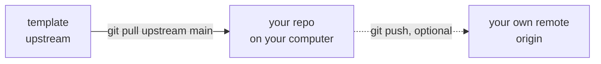

# 1-10 Get ready: your own repo

You set up the repo you will work in for the whole course. You clone the course template, install the packages, run
the checks, and learn how to pull new material from the template each week. At the end you make your first commit.

## Background

The template is a small Node.js project that is already set up. It is split in two parts:

| The teacher updates (do not edit) | You write |
|---|---|
| `doc/`, `exercise/` | everything else: `src/`, `public/`, `practice/`, `report/`, `README.md`, `CLAUDE.md`, the config files |

The files you get in your part at the start (`README.md`, the report templates, `package.json`, the config files)
are given once and never updated by the teacher, so they are yours to change.

Your repo has a remote called `upstream`: the template, where you pull new exercises and articles from. Since you
never edit the teacher's files, a pull from `upstream` does not give you conflicts.

Whether you also push your repo somewhere is up to you. You can work only locally, or push to a repo of your own on
GitHub, GitLab or a similar service, which gives you a backup and a place to show your code. The course does not need
it. If you push, your own repo is the remote `origin`.



## Before you start

You need the tools from [1-05 Lab environment](1-05-lab-environment.md): a bash terminal (Git Bash on Windows), Git,
Node.js 26 or later. An account and an SSH key on GitHub or GitLab are only needed if you want to push your repo
there.

## 1. Clone the template

You are in the terminal, in the directory where you keep your course work. Clone the template into a directory named
`intro-backend`, then rename its remote from `origin` to `upstream`, since it is where new material comes from:

```bash
git clone https://gitlab.com/mikael-roos/intro-backend/template.git intro-backend
cd intro-backend
git remote rename origin upstream
git remote -v
```

`git remote -v` shows `upstream` and the address of the template.

## 2. Push to your own remote (optional)

Skip this step if you work only locally; you can add a remote later.

1. Create a new, **empty** repo on GitHub, GitLab or a similar service. Do not add a README, `.gitignore` or licence;
   the template already has them.
2. Add it as `origin` and push. You are still in the root of your repo:

   ```bash
   git remote add origin <url-of-your-repo>
   git push -u origin main
   ```

3. Reload your repo in the browser: the template's files are now in it.

## 3. Install and run the checks

You are in the root of your repo. Install the packages the project uses:

```bash
npm install
```

This reads `package.json` and puts the packages in `node_modules/`. That directory is not committed (see
`.gitignore`); anyone who clones the repo runs `npm install` instead.

If it stops with `EBADENGINE`, your Node.js is older than the course needs: go back to 1-05 and install v26. If it ends
with a line like "3 moderate severity vulnerabilities", leave it: it concerns the tools that check your code, not the
app, and `npm audit fix` is not needed.

Open `package.json` and look at `scripts`. Run the check:

```bash
npm run check
```

It runs three things, all of which should pass:

| Script | Tool | What it does |
|---|---|---|
| `npm run lint` | ESLint (`eslint.config.js`) | Finds errors and suspicious code |
| `npm run format:check` | Prettier (`.prettierrc`) | Checks that the code follows one format: no semicolons, single quotes, 2 spaces |
| `npm test` | Node's built-in test runner | Runs every `*.test.js` file. There are none yet. `npm test -- src` runs only those in `src/` |

Two more scripts help you fix what the checks find:

```bash
npm run lint:fix   # let ESLint fix what it can
npm run format     # let Prettier format all files
```

Tests live next to the code they test: `todo.js` and `todo.test.js` in the same directory.

## 4. Look around

Open the repo in your editor and find these:

- `src/`: the app you build week by week.
- `public/`: static files (HTML, CSS, images) for the app.
- `practice/`: small exercises that stand on their own, one directory each.
- `report/`: one report per week. You fill in `week-01.md` at the end of this week.
- `exercise/` and `doc/`: the exercises and articles. New ones arrive each week. `doc/troubleshooting.md` collects
  the problems that show up in more than one exercise.
- `CLAUDE.md` and `AGENTS.md`: context for an AI assistant (Claude Code, Codex, Copilot and others), so it helps you
  learn instead of writing your code. Read `CLAUDE.md` once; it is yours to change.

## 5. Pull new material from the template

The teacher adds exercises and articles during the course. They arrive in `doc/` and `exercise/`, so leave those
alone:

- **Do not edit, move or delete** anything in `doc/` or `exercise/`. If you change a file there and the
  teacher changes it too, the pull stops with a merge conflict.
- **Want to take notes on an exercise?** Write them in your report, or in a file of your own outside those
  directories, for example `notes.md` in the root.
- **Commit your own work before you pull**, so your changes and the teacher's come in as separate commits.

Pull from the root of your repo:

```bash
git pull upstream main
```

Do it now. You get "Already up to date" if nothing is new. If you have a remote of your own, `git push` afterwards
sends the new material there too.

Later in the course you have commits of your own when you pull. Then Git merges the new material with your work and
makes a *merge commit*. It may open an editor with a message for it; the message is fine as it is, so save and close
the editor. If it opens in Vim, type `:wq` and press Enter. To skip the editor, pull with
`git pull --no-edit upstream main`.

## Check and commit

Start your report for the week: write a few lines in `report/week-01.md` about yourself and your setup (operating
system, editor, what was new). You continue the text at the end of the week. Then commit:

```bash
git add report/week-01.md
git commit -m "Get ready: my own repo"
```

If you have a remote of your own, push with `git push`.

### Verify

- [ ] `git log` shows your commit on top of the template's history.
- [ ] `git remote -v` shows `upstream` (the template), and `origin` if you push to a remote of your own.
- [ ] `npm run check` passes.
- [ ] You can say which files you may edit, and why that keeps `git pull upstream main` free of conflicts.

<details>
<summary><code>git push</code> says "Permission denied (publickey)"</summary>

Only if you push to a remote of your own. Your repo address is an SSH address, but your SSH key is not added to
GitHub or GitLab. Either add your key (see the
help pages of GitHub or GitLab, "SSH keys"), or switch to the HTTPS address:

```bash
git remote set-url origin <https-url-of-your-repo>
```

</details>

<details>
<summary><code>git pull</code> says "Need to specify how to reconcile divergent branches"</summary>

Git does not know whether to merge or rebase your commits with the new ones. Tell it to merge, once, and pull again:

```bash
git config --global pull.rebase false
git pull upstream main
```

</details>

<details>
<summary><code>git pull upstream main</code> gives a merge conflict</summary>

You have edited a file the teacher also changed, one in `doc/` or `exercise/`. Take the teacher's version
of that file and finish the merge:

```bash
git checkout --theirs <file>
git add <file>
git commit
```

</details>

## Read more

- The recorded lectures 1 and 2 in Canvas.
- npm scripts: https://docs.npmjs.com/cli/using-npm/scripts
- Git remotes: https://git-scm.com/book/en/v2/Git-Basics-Working-with-Remotes
