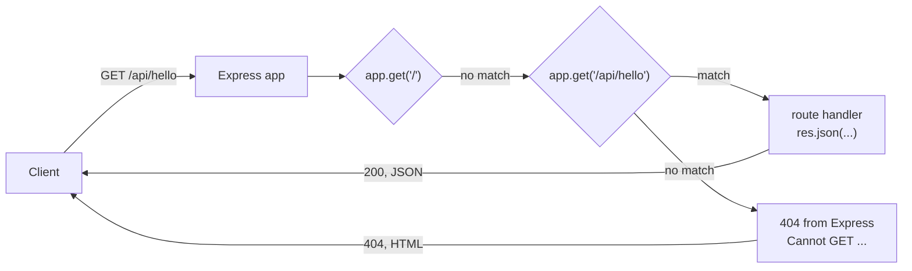

# 2-10 Hello Express: the web server with Express

In 1-30 you wrote a web server with `node:http`, the module that comes with Node.js. In this exercise you write the same
server again with Express, the most used web framework for Node.js, and compare the two.

This is what happens, step by step:

- You install Express, your first package from npm, the package registry of Node.js.
- You write the app in `src/app.js` and start it from `src/server.js`, split the same way as in 1-30.
- The app answers the same three ways as before: `Hello World` on `/`, JSON on `/api/hello` and 404 on everything
  else. The tests from 1-30 check that, nearly as they are.
- You put the two versions side by side and see what Express does for you: the same server needs much less code.

You need 1-30 done. When you are done, `src/` has three new files next to the ones from 1-30, and `package.json` lists
Express:

```
src/
├── app.js          the Express app: the routes
├── app.test.js     tests that call the app over HTTP
├── server.js       starts the app on a port
├── http-app.js     from 1-30, kept to compare with
├── http-app.test.js
└── http-server.js
```

The app in `app.js` and `server.js` is the one that grows through the rest of the course.

## Background: Express

Express is a package on npm: code someone else wrote, that you install into your repo. It sits on top of `node:http`
and takes over the parts you wrote by hand in 1-30:

- **Routing**: instead of one function with an `if` per path, you write one function per route with
  `app.get('/path', ...)`. Express calls the right one.
- **The response**: `res.send()` and `res.json()` set the status code, the `Content-Type` and the body for you.
- **404**: a path with no route gets a 404 without any code of yours.

Express tries the routes in the order you wrote them, and the first that matches the method and the path answers.
When none matches, Express answers 404 itself:



A route is a method, a path and a function, the *route handler*, that gets the request `req` and the response `res`:

```js
app.get('/api/hello', (req, res) => {
  res.json({ message: 'Hello World' })
})
```

We use Express 5. When you look something up, use the documentation of Express 5 at https://expressjs.com/en/5x/api.html.

## 1. See where you are

You have `src/http-app.js`, `src/http-server.js` and `src/http-app.test.js` from 1-30. They stay as they are.

## 2. Install Express

Run from the root of your repo:

```bash
npm install express
```

Three things changed:

- `package.json` has a new part, `dependencies`, with `express` and a version such as `^5.3.0`. `^5` means any
  version 5, but not 6.
- `package-lock.json` lists the exact version of Express and of every package Express needs in turn.
- `node_modules/` holds the code of all those packages. It is in `.gitignore`, so it is never committed: anyone who
  clones your repo gets the same packages with `npm install`.

Look at the change with `git diff package.json`. Both `package.json` and `package-lock.json` are committed.

## 3. Create the app

As in 1-30 the app and the start of the server are two files, so the tests can start the app on a port of their own.

Create `src/app.js` with one route:

```js
import express from 'express'

const app = express()

app.get('/', (req, res) => {
  res.send('Hello World\n')
})

export default app
```

`express()` creates the app, `app.get()` adds a route for `GET /`, and `export default` exports the app as the
module's main value. The one who imports it chooses the name: `import app from './app.js'`, without `{ }`.

Then create `src/server.js`:

```js
import app from './app.js'

const port = process.env.PORT ?? 3000

app.listen(port, (error) => {
  if (error) {
    throw error
  }
  console.log(`Server listening on http://localhost:${port}`)
})
```

In Express 5 the function given to `app.listen()` gets an `error` if the server could not start, for example when the
port is busy. Without the `if` the program would say "Server listening" even then.

Set the port and start the server with the script in `package.json`, which runs `node --watch src/server.js`:

```bash
export PORT=3000
npm run dev
```

The line `.env not found. Continuing without it.`, maybe printed twice, is fine: the script reads a `.env` file if
there is one, and you have none yet.

In a second terminal, set the port and try it:

```bash
export PORT=3000
curl -i http://localhost:$PORT/
curl -i http://localhost:$PORT/nope
```

Compare with the answers from 1-30:

- `/` gives `200` and `Hello World`, but the `Content-Type` is `text/html; charset=utf-8`: `res.send()` with a string
  takes for granted that it is HTML. A browser shows the text either way.
- `/nope` gives `404` with a small HTML page that says `Cannot GET /nope`, without a line of code from you.
- There are more headers, among them `X-Powered-By: Express`, `Content-Length` and `ETag`.

## 4. Answer with JSON

Add a route for `GET /api/hello` in `src/app.js`, after the route for `/`, that answers with this body:

```json
{ "message": "Hello World" }
```

Hint: `res.json()` takes an object, turns it into JSON and sets the `Content-Type` to `application/json`. Compare with
how you did it in `src/http-app.js`.

<details>
<summary>The route</summary>

```js
app.get('/api/hello', (req, res) => {
  res.json({ message: 'Hello World' })
})
```

</details>

Save, and the server restarts. Try it:

```bash
curl -i http://localhost:$PORT/api/hello
```

## 5. Test the app

You write new tests for the Express app, in `src/app.test.js`. They are built the same way as the tests you wrote in
1-30: before the tests, the app is started on port 0, which lets the operating system pick a free port, and each test
calls it with `fetch()`, as a client would.

Only the start is new. In 1-30, `createApp()` gave you a server, and the tests called `server.listen()`. An Express app
has a `listen()` of its own: `app.listen()` creates the server, starts it and returns it, so the tests can stop it with
`server.close()` when they are done.

### 5.1 The first tests

Create `src/app.test.js`:

```js
import { test, before, after } from 'node:test'
import assert from 'node:assert/strict'
import app from './app.js'

let server
let baseUrl

// Start the app on a free port before the tests, stop it after.
before(async () => {
  await new Promise((resolve) => {
    server = app.listen(0, resolve)
  })
  baseUrl = `http://localhost:${server.address().port}`
})

after(() => server.close())

test('GET / says Hello World', async () => {
  const res = await fetch(`${baseUrl}/`)
  assert.equal(res.status, 200)
  assert.equal(await res.text(), 'Hello World\n')
})

test('an unknown path gives 404', async () => {
  const res = await fetch(`${baseUrl}/nope`)
  assert.equal(res.status, 404)
})
```

Run them with `npm test -- src`. Both the tests of 1-30 and the new ones run.

The two tests are the same as in `src/http-app.test.js`, word for word. They test what the server answers, not how
the code is written, so they pass for both servers.

### 5.2 Test the JSON route

Copy your test for `GET /api/hello` from `src/http-app.test.js` and put it last in `src/app.test.js`. Run
`npm test -- src` again. Does it pass without changes?

<details>
<summary>A solution</summary>

```js
test('GET /api/hello answers with JSON', async () => {
  const res = await fetch(`${baseUrl}/api/hello`)
  assert.equal(res.status, 200)
  assert.match(res.headers.get('content-type'), /application\/json/)
  assert.deepEqual(await res.json(), { message: 'Hello World' })
})
```

It passes as it is: `res.json()` sets `application/json; charset=utf-8`, and `assert.match()` only checks that the
header contains `application/json`.

</details>

## 6. Compare the two servers

Open `src/http-app.js` and `src/app.js` side by side and think about these:

- Where is the `if` for each path in `http-app.js`, and what has taken its place in `app.js`?
- Where is the 404 in `app.js`?
- What does `res.json()` do that you did in three steps in `http-app.js`?
- What did you get from Express that you did not ask for (look at the headers from `curl -i`)?

<details>
<summary>One way to see it</summary>

The `if (req.method === 'GET' && req.url === '/api/hello')` is now `app.get('/api/hello', ...)`: Express looks at the
method and the path and calls the right route handler. A request that matches no route gets the 404 from Express.
`res.json()` turns the object into a string, sets the status code (200 unless you say otherwise) and the
`Content-Type`, and sends it, which was `writeHead()`, `JSON.stringify()` and `end()` in `http-app.js`.

The price is that some things happen without you seeing them, such as the `Content-Type` of `res.send()` and the
extra headers. You can change all of them, but first you need to know they are there.

</details>

## Check and commit

Stop the server with `Ctrl+C`, then:

```bash
npm run check
git add package.json package-lock.json src
git commit -m "2-10 Hello Express"
```

If you have a remote of your own, push with `git push`.

### Verify

- [ ] `npm run dev` starts the server, and `/`, `/api/hello` and `/nope` answer as they should in the browser and with
      `curl -i`.
- [ ] `package.json` lists `express` under `dependencies`, and `node_modules/` is not committed.
- [ ] `npm run check` passes, with the tests of both servers.
- [ ] You can say what Express does for you that you wrote yourself in `http-app.js`.

<details>
<summary><code>Cannot find package 'express'</code></summary>

Express is not installed in this repo. Run `npm install express` from the root of the repo (where `package.json`
is), and check that `package.json` lists it under `dependencies`. After a fresh clone, run `npm install`.

</details>

<details>
<summary><code>does not provide an export named 'default'</code></summary>

`app.js` must end with `export default app`, and the other files import it without `{ }`:
`import app from './app.js'`.

</details>

<details>
<summary><code>Error: listen EADDRINUSE: address already in use :::3000</code></summary>

A server is already running on port 3000, maybe the one from 1-30 in another terminal. Stop it with `Ctrl+C`, or
choose another port with `export PORT=3001` in both terminals and start the server again. If you cannot find the
terminal, find the process that holds the port and stop it:

```bash
# Git Bash on Windows: the last column is the process id (PID)
netstat -ano | grep :3000
taskkill //PID <pid> //F

# macOS and Linux
lsof -i :3000
kill <pid>
```

More in [Troubleshooting](../doc/troubleshooting.md).

</details>

<details>
<summary><code>npm warn EBADENGINE</code> or <code>npm error engine</code></summary>

Your Node.js is older than 26. Check with `node --version` and install a newer one as in
[1-05](1-05-lab-environment.md).

</details>

## Challenge

Add a second route for `GET /` last in `src/app.js`, one that answers another text. Which of the two answers when you
try `/` with `curl`? Move the new route above the first one and try again. Compare with the diagram in the
background: what does it tell you about the order of the routes? Remove the extra route when you are done.

## Read more

- [Express 5 in short](../doc/express-5.md): the app, routes, the answer, a router and errors, in one place.
- [Testing with Node.js](../doc/testing-with-node.md), the section "Testing a web server".
- Hello world in Express: https://expressjs.com/en/starter/hello-world.html
- Basic routing: https://expressjs.com/en/starter/basic-routing.html
- The Express 5 API, `app.get()`, `res.send()`, `res.json()`: https://expressjs.com/en/5x/api.html
- What `npm install` does with `package.json` and `package-lock.json`: https://docs.npmjs.com/cli/commands/npm-install
