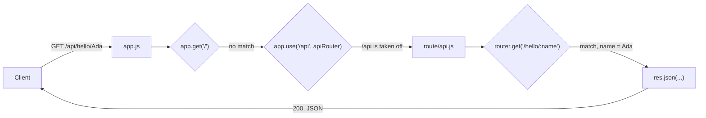
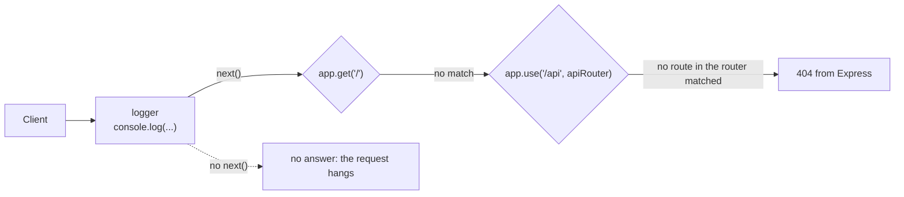

# 2-20 Routes: route parameters, the query string and a router

In 2-10 the routes of your app always answered the same thing. In this exercise they take input from the URL, the way
most routes of an API do, and answer with an error when the input is wrong.

This is what happens, step by step:

- You add a *route parameter*, a part of the path: `/api/hello/Ada` greets Ada.
- You read the *query string*, what comes after `?`: `?lang=sv` greets in Swedish.
- A language the app does not know gives `400 Bad Request`, with an error as JSON.
- You write a test for each new route and for the error.
- You move the API routes to a file of their own with `express.Router()`, and the tests show that the app still works
  without a change to them.
- You add a *middleware* that prints each request in the server's terminal.

You need 2-10 done; you go on with its app. When you are done, `src/` has one new file:

```
src/
├── app.js          the app: the route for / and where the API routes are mounted
├── app.test.js     tests that call the app over HTTP
├── server.js       starts the app on a port
└── route/
    └── api.js      the API routes, in a router
```

## Background: input in the URL

A URL can carry input to the server in two places:

```text
http://localhost:3000/api/hello/Ada?lang=sv
                     └──── path ───┘└ query ┘
```

- A **route parameter** is a named part of the path. The route `/api/hello/:name` matches `/api/hello/Ada` and
  `/api/hello/Bob`, and Express puts the value in `req.params.name`. Use it for *which* thing you ask for: a name, an
  id.
- The **query string** is a list of `key=value` pairs after `?`, separated by `&`. Express puts them in `req.query`,
  so `?lang=sv` gives `req.query.lang === 'sv'`. Use it for *how* you want the answer: a language, a filter, a sort
  order. It is optional: a key that is not in the URL is `undefined`.

Both are always strings. `/api/hello/42` gives `req.params.name === '42'`, not the number `42`.

## 1. See where you are

You have `src/app.js`, `src/server.js` and `src/app.test.js` from 2-10, with the routes `/` and `/api/hello`. Start
the server and leave it running through the exercise; it restarts each time you save:

```bash
export PORT=3000
npm run dev
```

Use a second terminal for `curl`, with `export PORT=3000` there too.

## 2. A route parameter

Add a route for `GET /api/hello/:name` in `src/app.js`, after the route for `/api/hello`, that greets the name in the
path:

```bash
curl -i http://localhost:$PORT/api/hello/Ada
```

```json
{ "message": "Hello Ada" }
```

Hint: the name is in `req.params.name`. A template literal, `` `Hello ${name}` ``, puts it into the string.

<details>
<summary>A solution</summary>

```js
app.get('/api/hello/:name', (req, res) => {
  res.json({ message: `Hello ${req.params.name}` })
})
```

</details>

Try a few names, and one with a space written as `%20`: `curl http://localhost:$PORT/api/hello/Ada%20Lovelace`. Express
decodes the `%20` for you. Does `/api/hello` without a name still answer `Hello World`?

Add a test last in `src/app.test.js` and run `npm test -- src`:

```js
test('GET /api/hello/:name greets the name', async () => {
  const res = await fetch(`${baseUrl}/api/hello/Ada`)
  assert.equal(res.status, 200)
  assert.deepEqual(await res.json(), { message: 'Hello Ada' })
})
```

## 3. The query string

Let the same route greet in Swedish when the URL ends in `?lang=sv`, and in English when `lang` is `en` or missing.
Put the greetings in an object before the routes, so a new language is one more line:

```js
const greetings = {
  en: 'Hello',
  sv: 'Hej',
}
```

```bash
curl -i "http://localhost:$PORT/api/hello/Ada?lang=sv"
```

```json
{ "message": "Hej Ada" }
```

Put quotes around a URL with `?` or `&` in the terminal. Without them bash may treat `?` as a wildcard and `&` as "run
in the background".

Hint: `req.query.lang ?? 'en'` gives `'en'` when `lang` is missing, and `greetings[lang]` looks up the greeting.

<details>
<summary>A solution</summary>

```js
app.get('/api/hello/:name', (req, res) => {
  const lang = req.query.lang ?? 'en'
  res.json({ message: `${greetings[lang]} ${req.params.name}` })
})
```

</details>

Now try a language that is not in the object:

```bash
curl -i "http://localhost:$PORT/api/hello/Ada?lang=xx"
```

You get `200 OK` and the message `undefined Ada`. The route takes for granted that the input is right, and it is not.

Add a test for Swedish. Fill in the parts:

```js
test('?lang=sv greets in Swedish', async () => {
  // 1. Fetch /api/hello/Ada?lang=sv
  // 2. Check that the status is 200
  // 3. Check that the body is { message: 'Hej Ada' }
})
```

<details>
<summary>A solution</summary>

```js
test('?lang=sv greets in Swedish', async () => {
  const res = await fetch(`${baseUrl}/api/hello/Ada?lang=sv`)
  assert.equal(res.status, 200)
  assert.deepEqual(await res.json(), { message: 'Hej Ada' })
})
```

</details>

## 4. Answer 400 on wrong input

When the client sends input the server cannot use, the answer is `400 Bad Request` with a message that says what was
wrong. `res.status()` sets the status code and returns `res`, so you can chain it:

```js
res.status(400).json({ error: 'Something was wrong' })
```

Change the route so a language that is not in `greetings` gives `400` and this body:

```json
{ "error": "Unknown language: xx" }
```

Hint: `Object.hasOwn(greetings, lang)` is `true` only for the keys you put in the object. Answer with the error and
`return`, so the route does not go on and answer a second time.

<details>
<summary>A solution</summary>

```js
app.get('/api/hello/:name', (req, res) => {
  const lang = req.query.lang ?? 'en'
  if (!Object.hasOwn(greetings, lang)) {
    res.status(400).json({ error: `Unknown language: ${lang}` })
    return
  }
  res.json({ message: `${greetings[lang]} ${req.params.name}` })
})
```

`Object.hasOwn()` and not `greetings[lang]`: every object has some keys of its own from JavaScript, so `?lang=toString`
would find a function in `greetings[lang]` and pass the check.

</details>

Try `?lang=xx`, `?lang=sv` and no `lang` with `curl -i`, and look at the status line.

Add a test for the error:

```js
test('an unknown language gives 400', async () => {
  // 1. Fetch /api/hello/Ada?lang=xx
  // 2. Check that the status is 400 and the Content-Type is JSON
  // 3. Check that the body is { error: 'Unknown language: xx' }
})
```

<details>
<summary>A solution</summary>

```js
test('an unknown language gives 400', async () => {
  const res = await fetch(`${baseUrl}/api/hello/Ada?lang=xx`)
  assert.equal(res.status, 400)
  assert.match(res.headers.get('content-type'), /application\/json/)
  assert.deepEqual(await res.json(), { error: 'Unknown language: xx' })
})
```

</details>

## 5. Move the API routes to a router

`app.js` grows by one route at a time, and through the course there will be many. A *router* is a small set of routes
that you can put in a file of its own and *mount* on a path in the app. All routes under `/api` go in
`src/route/api.js`.

Create `src/route/api.js`, and move `greetings` and the two `/api/hello` routes there:

```js
import express from 'express'

const router = express.Router()

const greetings = {
  en: 'Hello',
  sv: 'Hej',
}

router.get('/hello', (req, res) => {
  res.json({ message: 'Hello World' })
})

router.get('/hello/:name', (req, res) => {
  // the body of your route from step 4
})

export default router
```

Note the paths: `/hello`, not `/api/hello`. The router does not know where it is mounted; the app decides that.

Then remove the two routes and `greetings` from `src/app.js`, import the router and mount it on `/api`. `src/app.js`
is now short:

```js
import express from 'express'
import apiRouter from './route/api.js'

const app = express()

app.get('/', (req, res) => {
  res.send('Hello World\n')
})

app.use('/api', apiRouter)

export default app
```

`app.use('/api', apiRouter)` sends every request whose path starts with `/api` to the router, with `/api` taken off.
`/api/hello/Ada` reaches the router as `/hello/Ada`.



Run the tests, without changing them:

```bash
npm test -- src
```

They all pass. The tests call the app over HTTP and do not care which file a route is in, so you could move the code
and know right away that nothing broke. Changing how code is structured without changing what it does is called
*refactoring*, and tests are what make it safe.

Try `curl -i http://localhost:$PORT/api/nope` too. A path under `/api` that the router has no route for still gets
the 404 from Express.

## 6. A middleware that logs

A *middleware* is a function that Express runs on the way to the routes. It gets `req` and `res`, as a route handler
does, and a third parameter, `next`. It either answers, and the request stops there, or calls `next()`, and Express
goes on to what comes after it in `app.js`, in the order the lines are written.

Add a middleware that prints each request, right after `const app = express()`, so it comes before every route:

```js
const app = express()

// Print each request, then let it go on to the routes
app.use((req, res, next) => {
  console.log(req.method, req.url)
  next()
})
```

`app.use()` without a path runs the function for every request. Save, and try a few requests:

```bash
curl -i http://localhost:$PORT/api/hello/Ada
curl -i http://localhost:$PORT/api/nope
```

Look in the terminal where the server runs: one line per request, such as `GET /api/hello/Ada`, also for the path
that gives 404. Run `npm test -- src` too: the same lines are printed among the tests, since each test sends a real
request to the app.

The logger is now first on the way of every request, and `next()` lets the request go on:



Then take away the line `next()`, save and run the first `curl` again. It hangs: the middleware neither answers nor
lets the request go on. Stop `curl` with `Ctrl+C` and put the line back.

## Check and commit

Stop the server with `Ctrl+C`, then:

```bash
npm run check
git add src
git commit -m "2-20 Routes with parameters, query string and a router"
```

If you have a remote of your own, push with `git push`.

### Verify

- [ ] `/api/hello/Ada` answers `Hello Ada`, `?lang=sv` answers `Hej Ada`, and `?lang=xx` answers `400` with an error
      as JSON.
- [ ] The API routes are in `src/route/api.js`, mounted on `/api` in `src/app.js`.
- [ ] `npm run check` passes, with a test for each new route and for the error.
- [ ] You can say when to use a route parameter and when the query string.
- [ ] You can say why the tests did not change when you moved the routes.
- [ ] The server prints a line for each request, from a middleware in `src/app.js`, and you can say what `next()`
      does.

<details>
<summary>All routes give 404 after the move</summary>

Check the paths in the router: `/hello` and `/hello/:name`, without `/api`. With `/api/hello` in the router and
`app.use('/api', ...)` the route is reached on `/api/api/hello`. Check also that `app.js` has the line
`app.use('/api', apiRouter)`.

</details>

<details>
<summary><code>Cannot find module '.../src/route/api'</code></summary>

The import path needs the file ending and is relative to `app.js`: `'./route/api.js'`.

</details>

<details>
<summary><code>Error [ERR_HTTP_HEADERS_SENT]: Cannot set headers after they are sent to the client</code></summary>

The route answered twice: first the error, then the greeting. Put `return` after `res.status(400).json(...)`, so the
route stops there.

</details>

<details>
<summary>curl answers "no matches found" or the command hangs</summary>

The URL has a `?` or `&` without quotes. Put the whole URL in double quotes:
`curl -i "http://localhost:$PORT/api/hello/Ada?lang=sv"`.

</details>

## Challenge

Add a third language, and a route `GET /api/languages` that answers with the list of languages the API knows, taken
from the keys of `greetings` (look at `Object.keys()`). Then make `?lang=` case-insensitive, so `?lang=SV` works too.
Write a test for each.

## Read more

- [Express 5 in short](../doc/express-5.md): the app, routes, the answer, a router and errors, in one place.
- [Testing with Node.js](../doc/testing-with-node.md), the section "Testing a web server".
- Routing in Express, route parameters and `express.Router()`: https://expressjs.com/en/guide/routing.html
- `req.params`, `req.query` and `res.status()` in the Express 5 API: https://expressjs.com/en/5x/api.html
- HTTP status codes, 400 Bad Request: https://developer.mozilla.org/en-US/docs/Web/HTTP/Reference/Status/400
- `Object.hasOwn()`: https://developer.mozilla.org/en-US/docs/Web/JavaScript/Reference/Global_Objects/Object/hasOwn
