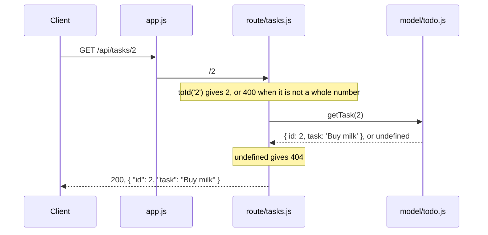

# 2-50 The to-do API: your own JSON API

In 1-20 you wrote the to-do list as a module, `todo.js`, and a main program that printed the list. In this exercise the
same module moves into your app in `src/` and gets routes: the app answers with the tasks as JSON. You write the code
yourself, and you start from your own code from 1-20. The exercise says what each route must answer and gives you hints,
and the tests are given: you add them first, see them fail, and write the code until they pass. There is no solution to
copy; it is shown in the Friday session of week 3.

This is what happens, step by step:

- You copy your module from 1-20 into `src/`, and let the server start with a few tasks in the list.
- You add the tests of two new functions in the module, see them fail, and write the functions, which give the tasks
  as objects with an `id`.
- You add the tests of the routes, see them fail, and write the routes, in a router of their own as in 2-25, one at a
  time, trying each with `curl`.

The to-do list grows through the course: in the coming weeks it moves to a database and gets more routes.

You need 1-20 and 2-25 done; you go on with the app in `src/`. When you are done, these files are new or changed:

```
src/
├── app.js              mounts the new router
├── server.js           starts the server with a few tasks
├── model/
│   ├── todo.js         your module from 1-20, with two new functions
│   └── todo.test.js    your tests from 1-20, with tests of the new functions
└── route/
    ├── tasks.js        the routes for the tasks
    └── tasks.test.js   the tests of the routes
```

## Background: a JSON API for the tasks

An API answers with JSON, also when something is wrong, so that a program can read every answer, not only a person.
Each task gets an `id`, its number in the list, so a client can ask for one task by its id:

| Route | Answer |
|---|---|
| `GET /api/tasks` | all tasks, as an array |
| `GET /api/tasks/:id` | one task |

This is the same as in 2-20: a route parameter, `res.json()`, and 400 or 404 with an error as JSON when the request
is wrong.

The route and the module share the work. The route reads the URL and picks the status code, the module finds the
task. A module like `todo.js`, which owns the data and the functions on it, is called a *model*, and it goes in
`src/model/`, next to `src/route/` (and `src/views/` if you did 2-30). The route handler itself decides what to answer;
there is no layer between the route and the model. When the tasks move to a database in the coming weeks, only the
inside of the model changes:



## 1. The module and a few tasks

Copy your module and its tests from 1-20 into `src/model/`, from the root of your repo:

```bash
mkdir -p src/model
cp practice/1-20/todo.js practice/1-20/todo.test.js src/model/
```

Your files in `practice/1-20/` stay as they are. Run the tests of `src/`, to see that the module works in its new
place, among the tests of the app:

```bash
npm test -- src
```

The list lives in memory and is empty when the server starts. Let `src/server.js` add a few tasks before it starts
the server, so there is something to ask for:

```js
import app from './app.js'
import { addTask } from './model/todo.js'

const port = process.env.PORT ?? 3000

// The list lives in memory and is empty when the server starts, so add a few tasks
addTask('Wash clothes')
addTask('Buy milk')
addTask('Call grandma')

app.listen(port, (error) => {
  if (error) {
    throw error
  }
  console.log(`Server listening on http://localhost:${port}`)
})
```

The tasks are added in `server.js`, not in `app.js`, since the tests use `app.js` and put their own tasks in the list.

## 2. The model: tests first

The model gets two new functions, `getTaskList()` for all tasks and `getTask(id)` for one, and you start with their
tests. Both give a task as an object with an `id`, its number in the list (1, 2, 3 …), since that is what the API
answers with:

```json
{ "id": 2, "task": "Buy milk" }
```

So far the module has only strings: `getTasks()` gives `['Wash clothes', 'Buy milk']`. Building the objects and
finding a task by its id is the job of the model, not of the routes, which only call the functions. `getTask(id)`
gives `undefined` when there is no task with that id.

### 2.1 The tests

Add the two names to the import at the top of `src/model/todo.test.js`, so it imports `getTaskList` and `getTask`
from `./todo.js` too. The line gets long, and `npm run format` splits it the way Prettier wants. Then add the tests
last in the file:

```js
test('getTaskList gives an empty array for an empty list', () => {
  assert.deepEqual(getTaskList(), [])
})

test('getTaskList gives each task with its id', () => {
  addTask('Wash clothes')
  addTask('Buy milk')
  assert.deepEqual(getTaskList(), [
    { id: 1, task: 'Wash clothes' },
    { id: 2, task: 'Buy milk' },
  ])
})

test('getTask gives the task with that id, or undefined', () => {
  addTask('Wash clothes')
  addTask('Buy milk')
  assert.deepEqual(getTask(2), { id: 2, task: 'Buy milk' })
  assert.equal(getTask(0), undefined)
  assert.equal(getTask(3), undefined)
})
```

Each test starts with an empty list, thanks to the `beforeEach(() => clearTasks())` you have from 1-20.

### 2.2 See them fail

Add the two functions last in `src/model/todo.js`, empty for now, so the tests have something to call:

```js
export function getTaskList() {
  // 1. Return all tasks as an array of objects { id, task }, where id is the number of the task (1, 2, 3 …)
}

export function getTask(id) {
  // 2. Return the task with that id as { id, task }, or undefined when there is none
}
```

Run the tests:

```bash
npm test -- src
```

The new tests fail, and the old ones still pass. Read the lines under a failing test: they show what was expected and
what the function gave, `undefined` for now. That is the list of what is left to do.

You can run only some of the tests, by a part of their names. This runs only the tests of `getTaskList()`:

```bash
npm test -- --test-name-pattern="getTaskList" src/model
```

More in [Testing with Node.js](../doc/testing-with-node.md), the section "Only one file, or only some tests".

### 2.3 Write the functions

Write the two functions until all tests pass. They return values and never print, and an id is a number here:
`getTask(2)`, not `getTask('2')`. Turning the string from the URL into a number is the job of the route.

Hints:

- `getTasksAsJson()` from 1-20 already builds such a list, with the key `number` instead of `id`. `getTaskList()`
  does the same, but returns the array itself, not a string: `res.json()` turns it into JSON later.
- `getTask()` can use `getTaskList()` and look for the object with that `id`. Look at `find()` in
  [Array on MDN](https://developer.mozilla.org/en-US/docs/Web/JavaScript/Reference/Global_Objects/Array/find).

## 3. The routes: tests first

The routes must answer like this:

| Request | Status | Body |
|---|---|---|
| `GET /api/tasks` | 200 | `[{ "id": 1, "task": "Wash clothes" }, { "id": 2, "task": "Buy milk" }, …]` |
| `GET /api/tasks/2` | 200 | `{ "id": 2, "task": "Buy milk" }` |
| `GET /api/tasks/42` | 404 | `{ "error": "Task 42 not found" }` |
| `GET /api/tasks/abc` | 400 | `{ "error": "The id must be a whole number" }` |

The wording of the error messages is yours; the tests check that there is an `error` with a text.

### 3.1 The tests

Create `src/route/tasks.test.js`. The tests put their own three tasks in the list and start the app on a free port, so
you do not need the server running when you run them:

```js
import { test, before, after } from 'node:test'
import assert from 'node:assert/strict'
import app from '../app.js'
import { addTask, clearTasks } from '../model/todo.js'

let server
let baseUrl

// Three tasks in the list, and the app on a free port (0).
before(async () => {
  clearTasks()
  addTask('Wash clothes')
  addTask('Buy milk')
  addTask('Call grandma')

  await new Promise((resolve) => {
    server = app.listen(0, resolve)
  })
  baseUrl = `http://localhost:${server.address().port}/api`
})

after(() => server.close())

// The status, the content-type and the body, read as JSON when it is JSON
async function get(path) {
  const res = await fetch(`${baseUrl}${path}`)
  const type = res.headers.get('content-type') ?? ''
  const body = type.includes('application/json') ? await res.json() : await res.text()
  return { status: res.status, type, body }
}

test('GET /tasks gives all tasks, with id and task', async () => {
  const { status, type, body } = await get('/tasks')
  assert.equal(status, 200)
  assert.match(type, /application\/json/)
  assert.deepEqual(body, [
    { id: 1, task: 'Wash clothes' },
    { id: 2, task: 'Buy milk' },
    { id: 3, task: 'Call grandma' },
  ])
})

test('GET /tasks/2 gives task 2', async () => {
  const { status, type, body } = await get('/tasks/2')
  assert.equal(status, 200)
  assert.match(type, /application\/json/)
  assert.deepEqual(body, { id: 2, task: 'Buy milk' })
})

test('a task that does not exist gives 404 with an error', async () => {
  for (const path of ['/tasks/0', '/tasks/4', '/tasks/9999']) {
    const { status, body } = await get(path)
    assert.equal(status, 404, path)
    assert.equal(typeof body.error, 'string', path)
  }
})

test('an id that is not a whole number gives 400 with an error', async () => {
  for (const path of ['/tasks/abc', '/tasks/1.5', '/tasks/-1']) {
    const { status, body } = await get(path)
    assert.equal(status, 400, path)
    assert.equal(typeof body.error, 'string', path)
  }
})
```

### 3.2 See them fail

Create `src/route/tasks.js` with an empty router, as `health.js` in 2-25:

```js
import express from 'express'

const router = express.Router()

// The routes for /api/tasks go here

export default router
```

Mount it in `src/app.js`, next to the other routers:

```js
import tasksRouter from './route/tasks.js'
```

```js
app.use('/api/tasks', tasksRouter)
```

The router is mounted on `/api/tasks`, so its paths are `/` and `/:id`, as `/api/tasks/2` reaches it as `/2`.

Run the tests with `npm test -- src`. The new ones fail: the router has no routes, so every request gets the 404 page
of Express, and a test says for example `404 !== 200`.

### 3.3 Write the routes

Write one route at a time, and try it both with `curl` and with the tests. Start the server:

```bash
export PORT=3000
npm run dev
```

In a second terminal, try each row of the table. The server has the three tasks from `server.js`:

```bash
export PORT=3000
curl -i http://localhost:$PORT/api/tasks
curl -i http://localhost:$PORT/api/tasks/2
curl -i http://localhost:$PORT/api/tasks/42
curl -i http://localhost:$PORT/api/tasks/abc
curl -i http://localhost:$PORT/api/tasks/1.5
curl -i http://localhost:$PORT/api/tasks/-1
```

The last three give 400, the one before 404. Then run the tests, `npm test -- src`, and go on until all of them pass.

To run only the tests of the route you work on, use a part of their names as in 2.2, for example
`--test-name-pattern="404"`.

Hints:

- The router imports the functions it needs from the model: `import { ... } from '../model/todo.js'`.
- The id comes as a string in `req.params.id`. Turn it into a number before you call `getTask()`. A small helper does
  it, and answers `undefined` when the string is not a whole number, so `abc`, `1.5` and `-1` are all wrong:

  ```js
  /** A whole number from the URL, or undefined when it is not one. */
  function toId(value) {
    return /^\d+$/.test(value) ? Number(value) : undefined
  }
  ```

  `/^\d+$/` is a regular expression that means "only digits, from start to end".

- 400 and 404 are answered as in 2-20: `return res.status(...).json({ error: ... })`, with `return` so the route
  stops there.
- Check the input first (400), then look for the task (404), then answer (200).

## Check and commit

Stop the server with `Ctrl+C`, then:

```bash
npm run check
git add src
git commit -m "2-50 The to-do API"
```

If you have a remote of your own, push with `git push`.

### Verify

- [ ] `npm run dev` starts the server, and every row in the table in step 3 answers as it should with `curl`.
- [ ] `npm run check` passes, with the tests of the module and of the routes.
- [ ] The routes in `route/tasks.js` get their tasks only through the functions in `model/todo.js`.
- [ ] You can say why the route turns the id into a number, and why `todo.js` takes a number and not a string.
- [ ] You can say when the answer is 200, 400 or 404.

<details>
<summary><code>Cannot GET /api/tasks</code>, after you wrote the route</summary>

The router is not mounted, or mounted on another path. Check that `src/app.js` imports `./route/tasks.js` and has
`app.use('/api/tasks', tasksRouter)`, and that the paths in the router are `/` and `/:id`, not `/tasks`.

</details>

<details>
<summary><code>does not provide an export named 'getTaskList'</code> (or <code>clearTasks</code>)</summary>

The function is missing in `src/model/todo.js`, or it has no `export` in front of it: add the empty functions from
step 2.2, and the tests fail one by one instead. `clearTasks()` is from 1-20; if
you did not write it then, add it now: it empties the list.

</details>

<details>
<summary>A test still says <code>404 !== 200</code> for <code>/tasks/2</code>, after you wrote the route</summary>

The id from the URL is the string `'2'`, and `task.id === '2'` is false for the number `2`. Turn the id into a number
in the route, with `toId()`, before you call `getTask()`.

</details>

<details>
<summary><code>npm test</code> or <code>curl</code> hangs and never ends</summary>

A route never answers: there is a way through it that reaches no `res.json()`, for example an `if` without the
answer in one of its branches. Run the request with `curl` to find which route it is, stop with `Ctrl+C`, and follow
the code of that route step by step.

</details>

## Challenge

Add `?search=` to `GET /api/tasks`, for the tasks whose text contains the search word: `/api/tasks?search=milk`. No
match is an empty array, not an error. Write the test first, then the code.

## Read more

- `Array.prototype.find()`:
  https://developer.mozilla.org/en-US/docs/Web/JavaScript/Reference/Global_Objects/Array/find
- Routing in Express: https://expressjs.com/en/guide/routing.html
- HTTP status codes 400 and 404:
  https://developer.mozilla.org/en-US/docs/Web/HTTP/Reference/Status/400 and
  https://developer.mozilla.org/en-US/docs/Web/HTTP/Reference/Status/404
- [Testing with Node.js](../doc/testing-with-node.md), the section "Testing a web server".
